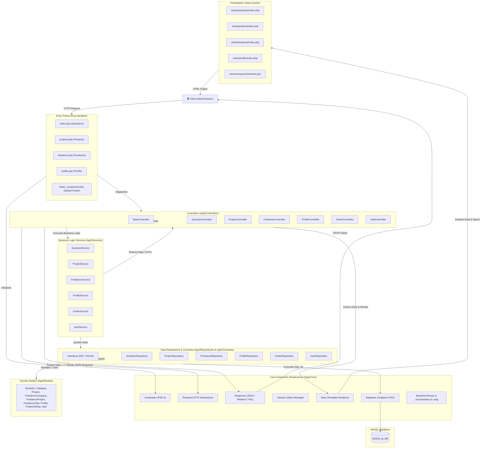

# Knowledge Repository & Freelance Management Platform

A high-performance, modular web application built with PHP (PHP 8.3+), adhering to the **MVC (Model-View-Controller)** pattern alongside **Service-Repository** architecture and SOLID design principles.

---

## 🏛️ Project Architecture Schematic

The application decouples presentation, HTTP handling, business logic, data access, and domain entities into isolated layers.



---

## 📁 Directory Structure Schematic

```
blog/
├── app/
│   ├── Config/
│   │   └── DatabaseConfig.php              # Centralized PDO connection & credentials configuration
│   ├── Contracts/                          # Repository & Service abstraction interfaces (DIP)
│   │   ├── AuthServiceInterface.php
│   │   ├── FooterRepositoryInterface.php
│   │   ├── FreelanceRepositoryInterface.php
│   │   ├── ProfileRepositoryInterface.php
│   │   ├── ProjectRepositoryInterface.php
│   │   ├── QuestionRepositoryInterface.php
│   │   ├── RepositoryInterface.php
│   │   └── UserRepositoryInterface.php
│   ├── Controllers/                        # Request dispatching, auth guards, & HTTP orchestration
│   │   ├── BaseController.php              # Shared base controller (View/JSON helpers, auth verification)
│   │   ├── AuthController.php              # Authentication & session verification endpoints
│   │   ├── FooterController.php            # Dynamic global footer settings & component rendering
│   │   ├── FreelanceController.php         # Companies, projects, tasks, & public share tokens
│   │   ├── ProfileController.php           # User profile info & updates
│   │   ├── ProjectController.php           # Portfolio projects CRUD & API endpoints
│   │   └── QuestionController.php          # Questions, categories, search, JSON import/export
│   ├── Core/                               # Framework infrastructure & utilities
│   │   ├── Autoloader.php                  # PSR-4 compliant autoloader for App\* namespace
│   │   ├── Database.php                    # Singleton PDO connection manager
│   │   ├── JsonSanitizer.php               # Robust JSON cleaning & unicode sanitation
│   │   ├── Lang.php                        # Localization & multi-language string helper
│   │   ├── MarkdownParser.php              # Markdown processing wrapper with Parsedown integration
│   │   ├── Request.php                     # HTTP request wrapper (GET, POST, files, JSON body)
│   │   ├── Response.php                    # HTTP response dispatcher (JSON, redirect, download)
│   │   ├── Session.php                     # Safe session initialization & state manager
│   │   └── View.php                        # View template rendering engine with variable extraction
│   ├── Models/                             # Domain entity definitions
│   │   ├── Category.php
│   │   ├── FooterSetting.php
│   │   ├── FreelanceCompany.php
│   │   ├── FreelanceProject.php
│   │   ├── FreelanceTask.php
│   │   ├── Profile.php
│   │   ├── Project.php
│   │   ├── Question.php
│   │   └── User.php
│   ├── Repositories/                       # Database query execution & data persistence
│   │   ├── BaseRepository.php              # Common repository base with PDO access
│   │   ├── FooterRepository.php
│   │   ├── FreelanceRepository.php
│   │   ├── ProfileRepository.php
│   │   ├── ProjectRepository.php
│   │   ├── QuestionRepository.php
│   │   └── UserRepository.php
│   └── Services/                           # Business logic, calculations, & workflows
│       ├── AuthService.php
│       ├── FooterService.php
│       ├── FreelanceService.php
│       ├── ProfileService.php
│       ├── ProjectService.php
│       └── QuestionService.php
├── assets/                                 # Static front-end assets
│   ├── css/                                # Component styling & particle animations
│   ├── fonts/                              # Self-hosted Inter, JetBrains Mono, & Poppins fonts
│   ├── js/                                 # Particles engine & front-end vendor libraries
│   ├── fonts.css
│   ├── poppins.css
│   ├── prism.min.css
│   └── prism.min.js
├── lang/
│   └── strings.php                         # Multi-language dictionary tokens
├── lib/
│   └── Parsedown.php                       # Markdown parser library
├── views/                                  # Presentation templates (Zero UI/CSS modification)
│   ├── components/
│   │   └── footer.php                      # Dynamic editable footer component
│   ├── freelance/
│   │   └── index.php                       # Freelance management view & client scripts
│   ├── profile/
│   │   └── index.php                       # Profile page view
│   ├── projects/
│   │   └── index.php                       # Projects showcase view
│   └── questions/
│       └── index.php                       # Questions & knowledge repository view
├── footer_component.php                    # Backward-compatible bridge for global footer
├── freelance.php                           # Slim entry point for Freelance module
├── index.php                               # Slim entry point for Questions module
├── profile.php                             # Slim entry point for Profile module
├── projects.php                            # Slim entry point for Projects module
├── q_db.sql                                # Complete database schema & initial dataset
└── README.md                               # Project documentation & schematic
```

---

## ⚙️ Layer Responsibilities

### 1. Entry Points (Root Files)
- **`index.php`**: Routes question repository views, category filtering, search, and import/export requests to `QuestionController`.
- **`projects.php`**: Dispatches portfolio showcase and project management requests to `ProjectController`.
- **`freelance.php`**: Dispatches freelance workspace, timesheet, invoicing, and task requests to `FreelanceController`.
- **`profile.php`**: Dispatches user biography, tech stack, and experience requests to `ProfileController`.
- **`footer_component.php`**: Provides a backward-compatible procedural wrapper (`renderGlobalFooter()`) delegating to `FooterController`.

### 2. Controllers (`app/Controllers/`)
- Acts as HTTP coordinators.
- Extracts incoming parameters through `App\Core\Request`.
- Performs authentication and authorization guards via `App\Services\AuthService`.
- Calls relevant Services to process domain logic.
- Returns JSON responses (`Response::json()`) for asynchronous AJAX requests, or renders HTML views (`View::render()`).

### 3. Services (`app/Services/`)
- Encapsulates pure business rules, independent of HTTP or database specifics.
- Examples: Time calculations and financial rate aggregation in `FreelanceService`, JSON format normalization in `QuestionService`, and authentication password verification in `AuthService`.

### 4. Repositories & Contracts (`app/Repositories/`, `app/Contracts/`)
- Encapsulates raw PDO SQL execution, transaction management, and schema-safe queries.
- Adheres to repository interface contracts (`*RepositoryInterface`) to enable dependency inversion, testability, and separation of data access from business logic.

### 5. Domain Models (`app/Models/`)
- Plain Old PHP Objects (POPOs) encapsulating model properties, attribute hydration, and array/JSON serialization methods.

### 6. Presentation Views (`views/`)
- Pure HTML5/CSS/JavaScript presentation templates.
- Consumes variables extracted by `App\Core\View::render($viewPath, $data)`.
- Completely decoupled from SQL and direct database calls.

---

## 🚀 Getting Started

### Prerequisites
- **PHP**: 8.1 or higher (PHP 8.3 recommended) with `pdo_mysql`, `mbstring`, and `json` extensions.
- **Web Server**: Apache / Nginx / WAMP / XAMPP.
- **Database**: MySQL 8.0+ or MariaDB 10.4+.

### Database Configuration
1. Import the database dump:
   ```bash
   mysql -u root -p q_db < q_db.sql
   ```
2. Configure database credentials in [`app/Config/DatabaseConfig.php`](file:///app/Config/DatabaseConfig.php):
   ```php
   public static function getHost(): string     { return 'localhost'; }
   public static function getDbName(): string   { return 'q_db'; }
   public static function getUsername(): string { return 'root'; }
   public static function getPassword(): string { return 'root'; }
   ```

### Running Locally
Place the project inside your web server directory (e.g. `c:\wamp64\www\blog`) and navigate to:
- Questions & Knowledge Base: `http://localhost/blog/`
- Projects Showcase: `http://localhost/blog/projects.php`
- Freelance Manager: `http://localhost/blog/freelance.php`
- Developer Profile: `http://localhost/blog/profile.php`
